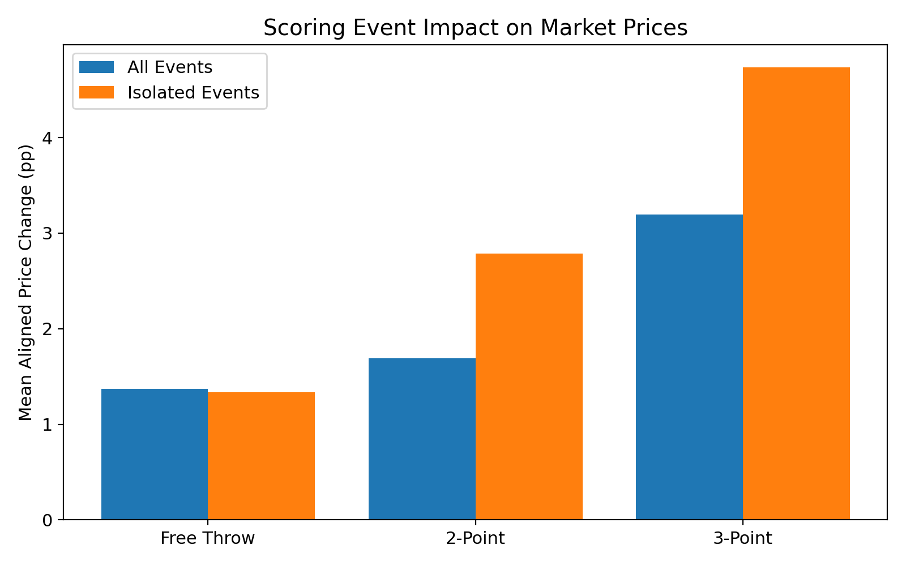
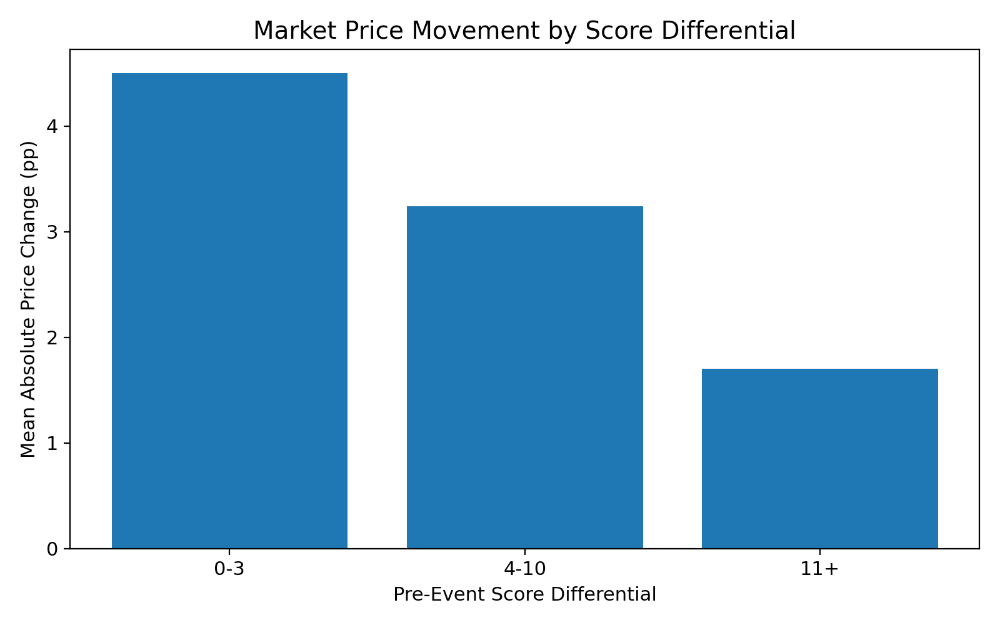
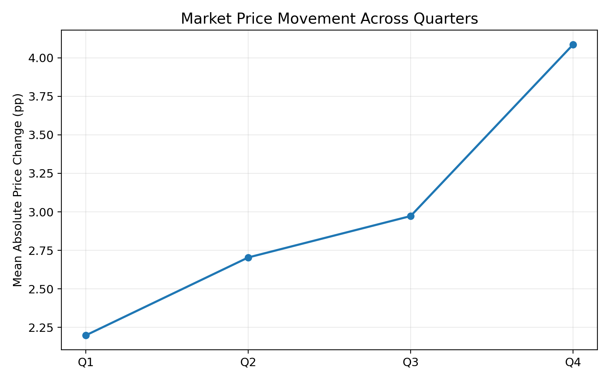
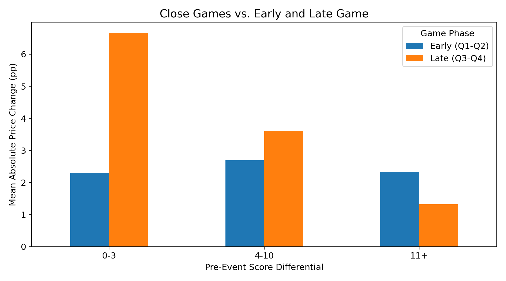
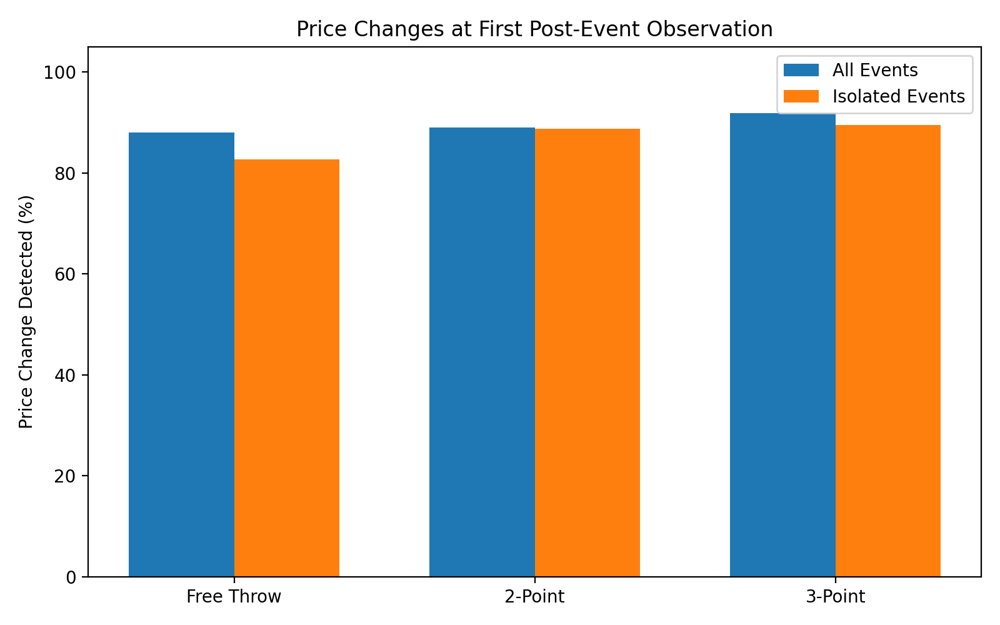
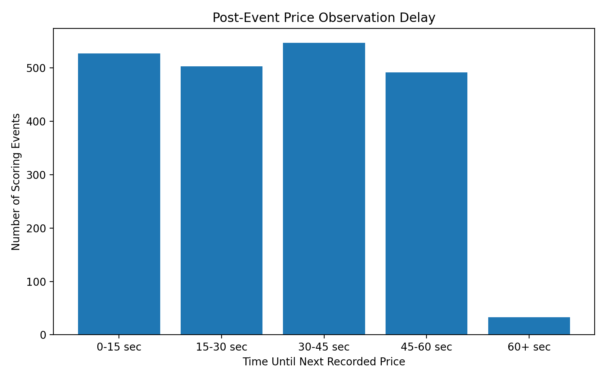

# NBA Scoring Events and Polymarket Price Movements

## 1. Project Overview

This project investigates the relationship between NBA
scoring events and Polymarket prediction-market price movements.

Data sources:
- ESPN NBA play-by-play
- Polymarket historical prices
- Apache Spark processing pipeline

The analysis is observational rather than causal.

## 2. Dataset

- NBA games: 16
- Scoring events: 2102
- Isolated scoring events: 631
- Non-isolated scoring events: 1471

An isolated event has no other scoring event within
the same selected market-price observation window.

## 3. Methodology

1. Collect historical NBA and Polymarket data.
2. Process and normalize data with PySpark.
3. Match NBA games to prediction-market tokens.
4. Join scoring events to surrounding price observations.
5. Compute scoring-team-aligned price changes.
6. Separate all events from isolated events.
7. Analyze scoring value, score differential and game period.
8. Estimate confidence intervals with game-clustered bootstrap.
9. Examine first-observation price-change detection.

All price differences are reported in probability units
unless the column explicitly uses percentage points (pp).

## 4. RQ1: Scoring Event Impact

### All Events

|   points_scored |   event_count |   avg_scoring_team_price_change |   avg_absolute_price_change |
|----------------:|--------------:|--------------------------------:|----------------------------:|
|           1.000 |       718.000 |                           0.014 |                       0.025 |
|           2.000 |       978.000 |                           0.017 |                       0.033 |
|           3.000 |       406.000 |                           0.032 |                       0.042 |

### Isolated Events

|   points_scored |   event_count |   avg_scoring_team_price_change |   avg_absolute_price_change |
|----------------:|--------------:|--------------------------------:|----------------------------:|
|           1.000 |       196.000 |                           0.013 |                       0.021 |
|           2.000 |       311.000 |                           0.028 |                       0.032 |
|           3.000 |       124.000 |                           0.047 |                       0.049 |

Three-point scoring events are associated with larger
average aligned market-price changes than two-point events
and one-point events.

Note: Price-change values in these two tables are raw
probability differences. Multiply by 100 to obtain pp.

## 5. RQ2: Market Price Movement

### By Score Differential

| score_category   |   event_count |   mean_absolute_change_pp |   mean_aligned_change_pp |
|:-----------------|--------------:|--------------------------:|-------------------------:|
| 0-3              |           703 |                     4.500 |                    2.746 |
| 4-10             |           807 |                     3.242 |                    1.833 |
| 11+              |           592 |                     1.703 |                    0.882 |

### By Game Phase and Score Differential

| game_phase    | score_category   |   event_count |   mean_absolute_change_pp |
|:--------------|:-----------------|--------------:|--------------------------:|
| Early (Q1-Q2) | 0-3              |           409 |                     2.298 |
| Early (Q1-Q2) | 4-10             |           381 |                     2.696 |
| Early (Q1-Q2) | 11+              |           224 |                     2.333 |
| Late (Q3-Q4)  | 0-3              |           248 |                     6.665 |
| Late (Q3-Q4)  | 4-10             |           404 |                     3.620 |
| Late (Q3-Q4)  | 11+              |           368 |                     1.319 |

Close games in later quarters exhibit larger average
absolute price movements than early close games.

## 6. Statistical Validation

Game-clustered bootstrap with 3,000 resamples:

| comparison                          |   observed_difference_pp |   ci_lower_95 |   ci_upper_95 |
|:------------------------------------|-------------------------:|--------------:|--------------:|
| Three-point vs two-point (all)      |                    1.508 |         0.859 |         2.216 |
| Three-point vs two-point (isolated) |                    1.948 |         0.600 |         3.383 |
| Close vs large lead                 |                    2.797 |         2.108 |         3.507 |
| Late close vs early close           |                    4.367 |         3.638 |         5.663 |

All four reported 95% percentile confidence intervals
exclude zero under the selected bootstrap procedure.

This does not establish causality.

## 7. RQ3: First-Observation Price Response

|   points_scored |   event_count |   fraction_price_changed |   mean_seconds_to_next_observation |
|----------------:|--------------:|-------------------------:|-----------------------------------:|
|           1.000 |       718.000 |                    0.880 |                             31.744 |
|           2.000 |       978.000 |                    0.890 |                             30.479 |
|           3.000 |       406.000 |                    0.919 |                             30.113 |

Overall:
- Events with a detected price change: 1875
- Detection rate: 89.20%
- Mean delay until next recorded price: 30.84 seconds

The recorded observation delay is not the true
market reaction latency.

## 8. Data Validation

- 8,385 ESPN timestamps aligned with UTC wallclock values.
- 2,102 event-price windows passed the window check.
- Zero invalid price windows.
- Median observation window length: 60 seconds.

## 9. Limitations

1. The sample includes only 16 games.
2. Price observations are approximately minute-level.
3. Some scoring events share overlapping price windows.
4. Isolated events may coincide with other game information.
5. Only one observed market token per game is represented.
6. The accuracy of the original market clock requires
   independent source-level validation.
7. Market price changes are observational associations.
8. The game-clustered bootstrap cannot remove confounding.
9. Multiple comparisons were performed.
10. Actual reaction latency cannot be directly measured.

## 10. Conclusion

Three-point scoring events, close score differentials,
and late-game situations are associated with larger
Polymarket price movements.

The findings are preliminary and should be interpreted
in light of the limited game sample, overlapping price
windows, and observational study design.
